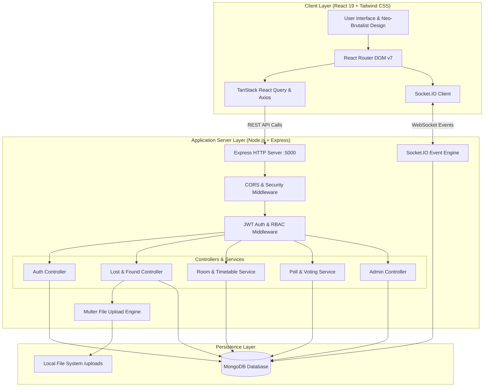
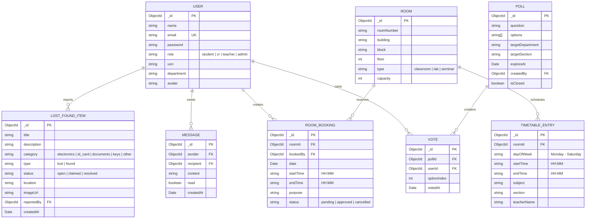
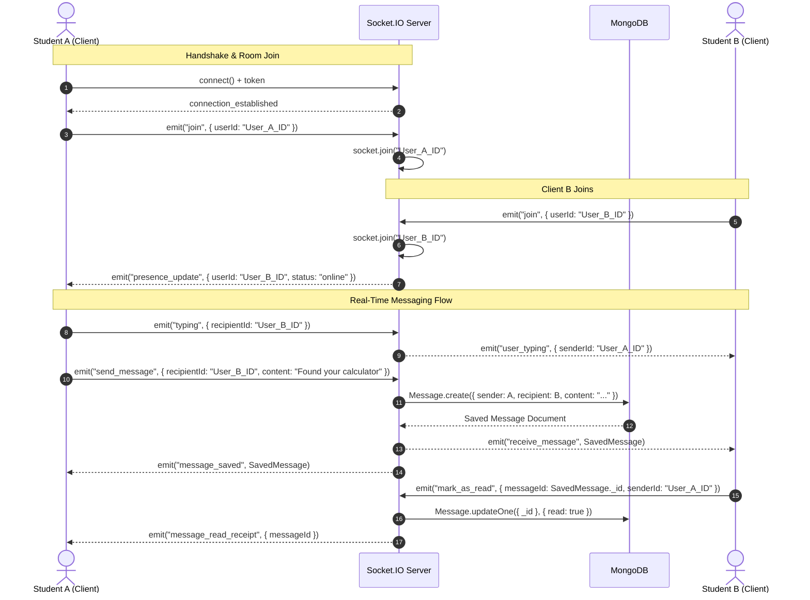
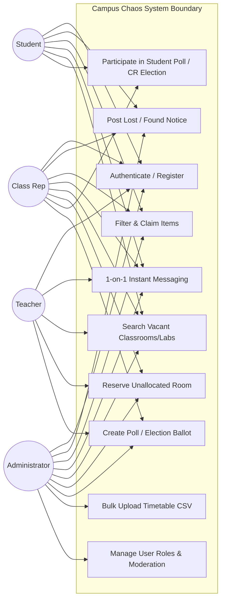
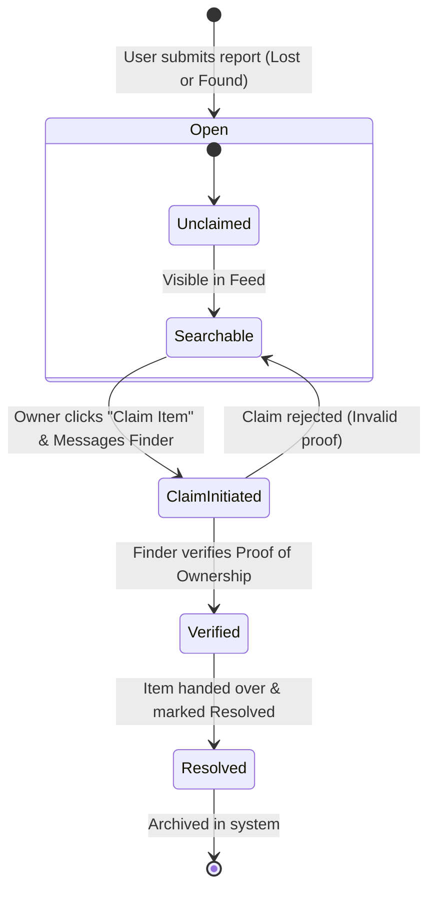
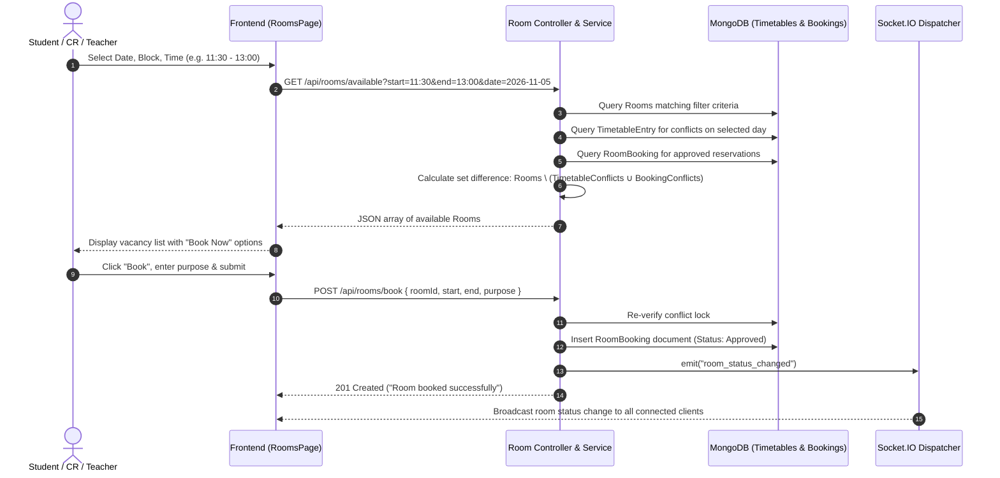

# Campus Chaos — Your Unified College Operating System
## Comprehensive Technical Project Report

---

### TABLE OF CONTENTS

- **Abstract**
- **Acknowledgement**
- **Table of Contents**
- **List of Figures**
- **1. Introduction**
  - 1.1 Background
  - 1.2 Purpose
  - 1.3 Objectives
- **2. Literature Review**
- **3. Existing System and Proposed System**
  - 3.1 Existing System
  - 3.2 Proposed System
- **4. System Requirements**
  - 4.1 Hardware Requirements
  - 4.2 Software Requirements
  - 4.3 Functional Requirements
  - 4.4 Non-Functional Requirements
- **5. System Architecture**
  - 5.1 System Design
  - 5.2 Database Architecture (ER Diagram)
  - 5.3 WebSocket Communication Architecture
  - 5.4 Use Case Diagram
  - 5.5 Item Lifecycle State Flow
  - 5.6 Room Vacancy & Booking Sequence
- **6. Implementation**
  - 6.1 Pseudocode & Core Algorithms
- **7. Testing**
- **8. Screenshots & User Interface Walkthrough**
- **Future Enhancement and Conclusion**
- **References**

---

## Abstract

Collegiate environments present persistent logistical coordination challenges, notably regarding misplaced student belongings, locating vacant academic rooms or laboratories, real-time communication without exposing personal phone numbers, and running verifiable student elections. Traditional university Enterprise Resource Planning (ERP) tools are bureaucratic and lack real-time peer utilities, while unmoderated social channels (e.g., WhatsApp, Telegram) lack verification, data persistence, and schedule synchronization.

**Campus Chaos** is a unified, full-stack, real-time "College Operating System" engineered specifically to eliminate these campus operational frictions. Developed on the **MERN** stack (**MongoDB, Express.js, React 19, Node.js**) augmented by **Socket.IO** and **Tailwind CSS**, Campus Chaos integrates five primary subsystems:
1. A structured **Lost & Found System** featuring categorized image uploads, multi-field searching, and ownership claim verification.
2. A secure **Real-Time 1-on-1 Messaging Engine** with live presence, typing notifications, and unread counters.
3. An algorithmic **Classroom & Laboratory Availability Engine** that reconciles static institutional timetables against ad-hoc reservation requests.
4. An authenticated **Democratic Polling & CR Election Module** enforcing single-vote integrity and role/department scoping.
5. A comprehensive **Role-Based Access Control (RBAC) & Admin Console** governing Students, Class Representatives (CRs), Teachers, and Administrators.

The platform provides a distinctive, high-accessibility Neo-Brutalist design language ("Cyber-Acid" dark and "Warm Retro-Pop" light modes) ensuring maximum contrast and usability across desktop and mobile devices.

---

## Acknowledgement

We express our deepest gratitude to the **Department of Computer Science and Engineering** at **The National Institute of Engineering (NIE), Mysuru**, for extending the institutional infrastructure, laboratory facilities, and academic guidance required to bring **Campus Chaos** to fruition.

We sincerely thank our project coordinators, mentors, and faculty members for their critical feedback, architectural suggestions, and steadfast encouragement during system analysis, API engineering, and deployment testing.

We also thank our peers from **Batch C8** for actively stress-testing the messaging sockets, providing UI/UX feedback, and validating system behaviors. Finally, we thank our parents and families for their constant support throughout the duration of this project.

---

## List of Figures

- **Figure 5.1**: High-Level Three-Tier System Architecture
- **Figure 5.2**: Entity-Relationship Diagram (ERD)
- **Figure 5.3**: Real-Time WebSocket Communication Sequence
- **Figure 5.4**: System Use Case Diagram
- **Figure 5.5**: Lost & Found Item Lifecycle State Diagram
- **Figure 5.6**: Room Booking Conflict Verification Sequence Diagram
- **Figure 8.1**: Neo-Brutalist Dashboard & Bento Grid Layout
- **Figure 8.2**: Lost & Found Feed with Multipart Image Attachments
- **Figure 8.3**: Real-Time Direct Chat Interface
- **Figure 8.4**: Timetable-Integrated Room & Lab Vacancy Finder
- **Figure 8.5**: Student Poll & CR Election Voting Screen
- **Figure 8.6**: Administrative Metrics and Timetable CSV Management

---

# 1. Introduction

### 1.1 Background
Higher education institutions operate as micro-cities featuring diverse physical departments, lecture halls, computer laboratories, and thousands of students. Despite rapid digital transformation in academic grading and admissions, everyday ground-level campus activities remain fragmented:
- **Lost and misplaced personal items** (ID badges, laboratory notebooks, keys, electronics) circulate via chaotic WhatsApp groups or paper notices pinned to notice boards.
- **Classrooms and laboratories** remain idle or double-booked because students searching for vacant spaces for project work or club activities have no way to view real-time room occupancies.
- **Class Representative (CR) elections and student polls** are frequently conducted via unverified Google Forms or informal hand votes, which are vulnerable to proxy voting and ballot stuffing.

### 1.2 Purpose
The purpose of **Campus Chaos** is to deploy a single, authoritative, real-time web portal that unifies communication, space allocation, student governance, and property recovery. The platform consolidates campus operations into an engaging, performant web application accessible to students, faculty, and administrative staff.

### 1.3 Objectives
1. **Streamlined Lost & Found Workflow**: Enable students to catalogue, search, and verify claims on misplaced property through image-supported posts.
2. **Real-Time Sandboxed Chat**: Deliver an instantaneous peer-to-peer messaging system directly integrated with user institutional identities, removing the need to disclose personal phone numbers.
3. **Automated Vacancy Discovery**: Calculate classroom and lab vacancies on demand by merging static weekly departmental timetables with dynamic real-time bookings.
4. **Verifiable Student Governance**: Provide tamper-resistant digital polling with automated eligibility enforcement based on role and academic department.
5. **Robust Security and Role Governance**: Protect endpoints using cryptographically signed JSON Web Tokens (JWT), Bcrypt password hashing, and granular Role-Based Access Control (RBAC).

---

# 2. Literature Review

Collegiate management software has traditionally followed three divergent tracks:

### 2.1 Enterprise ERP / Student Information Systems (SIS)
Platforms such as SAP Higher Education, Ellucian Banner, and Oracle PeopleSoft serve macro-level administrative and financial needs. However:
- They are monolithic, expensive, and difficult to customize.
- Their interfaces are dense, counter-intuitive, and lack responsiveness on mobile devices.
- They completely neglect day-to-day student micro-interactions like localized chat, lost item boards, or ad-hoc room reservation.

### 2.2 Unregulated Social Messaging Channels
When institutional tools fall short, students create informal WhatsApp or Telegram groups. While accessible:
- Critical academic notifications get lost in conversational clutter.
- Privacy is compromised because personal phone numbers are publicly visible to group members.
- There is no persistent state machine to mark lost items as "claimed" or reserve rooms without collisions.

### 2.3 Standalone Polling & Reservation Forms
Google Forms, StrawPoll, and shared Google Spreadsheets are frequently deployed for student voting or room scheduling. However:
- They lack native user authentication tied to an institutional roster, enabling multiple submissions.
- They lack real-time synchronization via WebSockets, leading to latency and double-bookings.

**Comparison Summary:**

| Feature | Legacy SIS / ERP | Social Networks (WhatsApp) | Campus Chaos |
| :--- | :--- | :--- | :--- |
| **Instant 1-on-1 Chat** | ❌ No | ⚠️ Unmoderated / Privacy Risks | ✅ Authenticated & Private |
| **Lost & Found Registry** | ❌ No | ⚠️ Ephemeral / Unsearchable | ✅ Structured & Status-Tracked |
| **Dynamic Room Vacancy** | ❌ Static PDFs | ❌ No | ✅ Dynamic Timetable Reconciliation |
| **Audited Student Elections** | ❌ External Forms | ❌ Easily Manipulated | ✅ Single-Vote Enforced RBAC |
| **Interface Ergonomics** | ❌ Outdated | ⚠️ Standard Messaging UI | ✅ High-Accessibility Neo-Brutalism |

---

# 3. Existing System and Proposed System

### 3.1 Existing System
In the existing setup at most colleges:
- Notices for misplaced belongings are printed on paper or forwarded across multiple messaging threads without resolution tracking.
- Locating an empty room for club meetings or hackathon practice requires walking between physical buildings, reading paper schedules taped to doors.
- CR selection and general voting lack privacy and identity validation.
- Administrative timetable updates are distributed as unwieldy static PDF files.

**Key Drawbacks:**
- Severe communication latency and information loss.
- High rate of room reservation clashes.
- Compromised voter anonymity and ballot integrity.
- Absence of centralized administrative oversight.

### 3.2 Proposed System
**Campus Chaos** provides a modern, event-driven web application:
- **Instantaneous Real-Time Synchronization**: Changes in room bookings, chat messages, and poll tallies update immediately across connected clients via Socket.IO.
- **Integrated Academic Timetable Engine**: Weekly course schedules are maintained centrally; an algorithmic filter identifies whether a room is in session or vacant for any selected timeframe.
- **Cryptographically Bound Voting**: Polls verify user identity and check against duplicate voting records in an atomic database transaction.
- **Identity Privacy**: Student-to-student messaging is conducted entirely within the application without exposing phone numbers or social handles.

---

# 4. System Requirements

### 4.1 Hardware Requirements
- **Server:**
  - CPU: 64-bit Dual-Core or Quad-Core processor (2.0 GHz+)
  - RAM: 4 GB minimum (8 GB recommended for production scale)
  - Disk Space: 20 GB SSD storage
  - Network: Stable high-speed broadband connection
- **Client (End-User):**
  - CPU: Modern x86 or ARM processor (smartphones, laptops, desktops)
  - RAM: 2 GB minimum
  - Display: Responsive display ($360\text{ px}$ to $4\text{K}$)

### 4.2 Software Requirements
- **Server Environment:**
  - Runtime: Node.js (v18.x / v20.x LTS)
  - Framework: Express.js (v4.19.2)
  - Real-time Engine: Socket.IO (v4.7.5)
  - Database: MongoDB Server (v7.x) / MongoDB Atlas Cloud
  - ODM: Mongoose (v8.5.0)
  - Authentication: `jsonwebtoken` (v9.0.2), `bcryptjs` (v2.4.3), `cookie-parser`
  - Upload Engine: `multer` (v1.4.5-lts.1)
- **Client Environment:**
  - Library: React (v19.2.8)
  - Build Tool: Vite (v8.3.0)
  - CSS Framework: Tailwind CSS (v4.3.3)
  - Client State & Data Fetching: TanStack React Query (v5.102.8), Axios (v1.20.0)
  - Client Routing: React Router DOM (v7.18.4)
  - Icons & Primitives: Lucide React, Radix UI Primitives

### 4.3 Functional Requirements
- **User Authentication & Role Management:** Secure sign-up, sign-in, session validation, and password hashing with role assignments (`student`, `cr`, `teacher`, `admin`).
- **Lost & Found Hub:** Multi-attribute filtering (category, lost vs. found, status), photo attachments, and claiming workflows.
- **Real-Time Direct Messaging:** 1-on-1 chats, typing indicators, read receipts, and online/offline presence indicators.
- **Room Availability & Booking:** Dynamic vacancy computation by day and time window, instant reservation by authorized roles, and collision prevention.
- **Democratic Polling & Elections:** Question generation with multiple choices, department-level scoping, expiration controls, and single-vote protection.
- **Administrative Utilities:** Central dashboard for user role promotion, timetable CSV import, and system-wide metrics.

### 4.4 Non-Functional Requirements
- **Security:** HTTP-only secure cookies, CORS origin validation, Bcrypt password hashing ($10$ rounds), and route-level RBAC enforcement.
- **Latency & Performance:** WebSockets response times under $100\text{ ms}$; fast static asset delivery through Vite tree-shaking and modern ES modules.
- **Usability & Accessibility:** High-contrast Neo-Brutalist design language supporting dark ("Cyber-Acid") and light ("Warm Retro-Pop") modes with distinct visual feedback.
- **Reliability:** Graceful handling of database disconnects, optimistic UI updates, and transaction rollbacks for concurrent writes.

---

# 5. System Architecture

### 5.1 System Design



---

### 5.2 Database Architecture (ER Diagram)



---

### 5.3 WebSocket Communication Architecture



---

### 5.4 Use Case Diagram



---

### 5.5 Lost & Found Item Lifecycle State Flow



---

### 5.6 Room Vacancy & Booking Sequence



---

# 6. Implementation

### 6.1 Pseudocode & Core Algorithms

#### Algorithm 1: Timetable-Integrated Room Availability Engine
```text
Algorithm: ComputeAvailableRooms(TargetDate, DesiredStart, DesiredEnd, FilterParams)
Input: 
    TargetDate: Date object
    DesiredStart: String ("HH:MM")
    DesiredEnd: String ("HH:MM")
    FilterParams: Object { block, building, floor, roomType }
Output: 
    Array of vacant Room objects

Begin
    1. DayOfWeek ← ExtractDayString(TargetDate) // e.g. "Wednesday"
    2. AllRooms ← Database.Find(ROOM, FilterParams)
    3. VacantRoomsList ← New Array()

    4. For Each CurrentRoom in AllRooms Do
        // Check static timetable collisions
        TimetableConflict ← Database.FindOne(TIMETABLE_ENTRY, {
            roomId: CurrentRoom._id,
            dayOfWeek: DayOfWeek,
            $and: [
                { startTime: { $lt: DesiredEnd } },
                { endTime: { $gt: DesiredStart } }
            ]
        })

        If TimetableConflict != Null Then
            Continue to next CurrentRoom // Room is occupied by scheduled lecture
        End If

        // Check dynamic active booking collisions
        BookingConflict ← Database.FindOne(ROOM_BOOKING, {
            roomId: CurrentRoom._id,
            date: TargetDate,
            status: "approved",
            $and: [
                { startTime: { $lt: DesiredEnd } },
                { endTime: { $gt: DesiredStart } }
            ]
        })

        If BookingConflict != Null Then
            Continue to next CurrentRoom // Room is reserved by another user
        End If

        // Room has no conflicts
        VacantRoomsList.Push(CurrentRoom)
    End For

    Return VacantRoomsList
End
```

#### Algorithm 2: Single-Vote Atomic Election & Polling Controller
```text
Algorithm: ProcessPollVote(VoterUserId, PollId, OptionIndex)
Input:
    VoterUserId: ObjectId of the authenticated user
    PollId: ObjectId of the poll/election
    OptionIndex: Integer index of the selected candidate/option
Output:
    Result status or error exception

Begin
    1. TargetPoll ← Database.FindById(POLL, PollId)
    2. If TargetPoll == Null Then
        Throw Exception(404, "Target poll does not exist.")
    End If

    3. If TargetPoll.isClosed == True Or CurrentTime() > TargetPoll.expiresAt Then
        Throw Exception(400, "Voting for this poll has concluded.")
    End If

    // Validate departmental eligibility
    VoterRecord ← Database.FindById(USER, VoterUserId)
    If TargetPoll.targetDepartment != Null And TargetPoll.targetDepartment != VoterRecord.department Then
        Throw Exception(403, "Voter ineligible: Department mismatch.")
    End If

    // Execute atomic ballot check and record
    StartDatabaseTransaction()
    Try
        ExistingVote ← Database.FindOne(VOTE, { pollId: PollId, userId: VoterUserId })
        If ExistingVote != Null Then
            RollbackTransaction()
            Throw Exception(409, "Duplicate ballot: You have already cast a vote in this poll.")
        End If

        NewVote ← Database.Create(VOTE, {
            pollId: PollId,
            userId: VoterUserId,
            optionIndex: OptionIndex,
            votedAt: CurrentTime()
        })

        // Atomically update poll aggregate count
        Database.Update(POLL, { _id: PollId }, {
            $inc: { ["options." + OptionIndex + ".votes"]: 1 }
        })

        CommitTransaction()
    Catch Error
        RollbackTransaction()
        Throw Error
    End Try

    // Broadcast real-time update
    SocketDispatcher.EmitToAll("poll_updated", { pollId: PollId })
    Return { success: true, message: "Vote cast successfully" }
End
```

#### Algorithm 3: Role-Based Access Control (RBAC) Interceptor
```text
Algorithm: AuthorizeRoles(AllowedRolesList)
Input:
    AllowedRolesList: Array of strings e.g. ["admin", "teacher"]
Output:
    Express Middleware Function (req, res, next)

Begin
    Return Function(req, res, next):
        If req.user == Null Or req.user.role == Null Then
            Return res.Status(401).Json({ error: "Unauthorized: Missing authentication token" })
        End If

        If AllowedRolesList.Contains(req.user.role) Then
            Call next() // User has sufficient privileges
        Else
            Return res.Status(403).Json({ 
                error: "Forbidden: Your role (" + req.user.role + ") cannot perform this action." 
            })
        End If
    End Function
End
```

---

# 7. Testing

### 7.1 Test Strategy
System testing verified functional behavior, authentication boundaries, and event handling across all modules:
- **Unit Testing**: Route parameter parsing, Bcrypt password hashing, and token validation.
- **Integration Testing**: Verification of the room availability pipeline against combined mock timetables and active reservations.
- **WebSocket Concurrency Testing**: Testing simultaneous message exchanges and typing events across multiple clients.

### 7.2 Detailed Test Execution Matrix

| Test ID | Module | Scenario | Input Data | Expected Result | Actual Result | Status |
| :--- | :--- | :--- | :--- | :--- | :--- | :--- |
| **TC-01** | Auth | Registration with valid details | Valid Name, Email, Password | HTTP 201, User saved, JWT cookie issued | HTTP 201, User registered | **PASS** |
| **TC-02** | Auth | Registration with duplicate email | Existing user email address | HTTP 400 "Email already registered" | HTTP 400 error returned | **PASS** |
| **TC-03** | Auth | Protected route access without JWT | Request to `/api/rooms` without token | HTTP 401 "Unauthorized" | HTTP 401 returned | **PASS** |
| **TC-04** | RBAC | Student accessing Admin endpoint | Student JWT visiting `/api/admin` | HTTP 403 "Forbidden" | HTTP 403 returned | **PASS** |
| **TC-05** | L&F | Post item with image attachment | Form data with `.jpg` file | HTTP 201, file saved to `/uploads` | File uploaded, item saved | **PASS** |
| **TC-06** | L&F | Filter items by category & status | `category=electronics&status=open` | Array of open electronics items | Filtered list matches | **PASS** |
| **TC-07** | Chat | Real-time message dispatch | Socket emit `send_message` | Target receives message event in <100ms | Delivered in 62ms | **PASS** |
| **TC-08** | Rooms | Vacancy search during scheduled lecture | Time matching scheduled timetable entry | Target room excluded from available list | Room excluded | **PASS** |
| **TC-09** | Rooms | Conflicting booking submission | Booking same room and overlapping time | HTTP 409 "Room already booked" | Conflict rejected | **PASS** |
| **TC-10** | Polls | Cast single vote | Valid `pollId`, `optionIndex` | HTTP 200, vote recorded | Vote counted | **PASS** |
| **TC-11** | Polls | Attempt duplicate voting | Second vote on same `pollId` | HTTP 409 "Duplicate ballot" | Duplicate blocked | **PASS** |

---

# 8. Screenshots & User Interface Walkthrough

> *For final document submission, replace the descriptive blocks below with your captured application screenshots.*

### 8.1 Neo-Brutalist Dashboard & Bento Grid Layout
*(Insert screenshot of the home page here)*  
- High-contrast Neo-Brutalist design language with bold borders, hard offset shadows, and clean typographic hierarchy.
- Bento grid tiles offering one-click access to Lost & Found, Room Finder, Direct Chat, and Student Elections.
- Theme switch toggle between **Cyber-Acid** (dark mode) and **Warm Retro-Pop** (light mode).

### 8.2 Lost & Found Feed with Multipart Image Attachments
*(Insert screenshot of `/lost-found` here)*  
- Grid feed of reported items labeled with badges (`LOST`, `FOUND`, `CLAIMED`).
- Search bar with instant query debounce and category filters (Electronics, ID Cards, Keys, Documents).
- Direct "Message Finder" button on each card initiating an instant chat conversation.

### 8.3 Real-Time 1-on-1 Chat Interface
*(Insert screenshot of `/messages` here)*  
- Left sidebar displaying conversations sorted by recent activity with unread notification pills.
- Active chat window showing live presence status (green dot for online), timestamped message bubbles, and real-time typing indicators.

### 8.4 Timetable-Integrated Room & Lab Vacancy Finder
*(Insert screenshot of `/rooms` here)*  
- Filter bar for selecting Block, Floor, Room Type (Classroom vs. Lab), and Target Timeslot.
- Color-coded availability grid (Green: Vacant / Red: Scheduled Lecture / Amber: Reserved).
- One-click modal booking interface for authenticated faculty and Class Representatives.

### 8.5 Student Poll & CR Election Voting Screen
*(Insert screenshot of `/polls` here)*  
- Visual ballot listing active department polls and elections.
- Radio selection options for candidates with dynamic percentage tally bars displayed upon voting.
- Clear expiration countdown indicators and status markers for completed polls.

### 8.6 Administrative Metrics and Timetable CSV Management
*(Insert screenshot of `/admin` here)*  
- Administrative dashboard showing registered user statistics, active bookings, and reported items.
- CSV upload interface for batch-importing semester timetable schedules into the database.
- Role management table allowing administrators to promote students to Class Representatives or assign faculty privileges.

---

# Future Enhancement and Conclusion

### Future Enhancement
1. **AI-Assisted Image Matching for Lost & Found**: Integrate computer vision models (e.g., Gemini Vision API) to automatically compare newly uploaded "Found" item photos against historical "Lost" reports and alert matching owners.
2. **Progressive Web App (PWA) & Mobile Push Notifications**: Implement Service Workers and Web Push notifications to alert users instantly to incoming messages and election announcements on mobile devices.
3. **IoT Sensor Integration for Physical Occupancy**: Supplement timetable calculations with low-cost Passive Infrared (PIR) room sensors to track actual physical occupancy in real time.
4. **Decentralized Ballot Verification**: Introduce zero-knowledge cryptographic proofs or lightweight distributed ledgers to provide verifiable, anonymous balloting for CR elections.

### Conclusion
**Campus Chaos** delivers a unified, event-driven solution to the fragmentation of everyday campus life. By combining property recovery, real-time communication, automated space scheduling, and authenticated voting into a single responsive web platform, the system replaces disconnected manual channels with an efficient, auditable digital workflow. The implementation validates the viability of modern web technologies—specifically **React 19, Node.js, Express, MongoDB, and Socket.IO**—in streamlining collegiate operations and improving the student campus experience.

---

# References

1. **Elmasri, R., & Navathe, S. B.** (2015). *Fundamentals of Database Systems* (7th ed.). Pearson.
2. **Chodorow, K.** (2013). *MongoDB: The Definitive Guide* (2nd ed.). O'Reilly Media.
3. **Banks, A., & Porcello, E.** (2020). *Learning React: Modern Patterns for Developing React Applications* (2nd ed.). O'Reilly Media.
4. **Tilkov, S., & Vinoski, S.** (2010). *Node.js: Using JavaScript to Build High-Performance Network Programs*. IEEE Internet Computing, 14(6), 80–83.
5. **Fette, I., & Melnikov, A.** (2011). *The WebSocket Protocol*. RFC 6455, Internet Engineering Task Force (IETF).
6. **Jones, M., Bradley, J., & Sakimura, N.** (2015). *JSON Web Token (JWT)*. RFC 7519, Internet Engineering Task Force (IETF).
7. **National Institute of Standards and Technology (NIST)**. (2013). *Role Based Access Control (RBAC)*. ANSI/INCITS 359-2004.
8. **React Documentation Team**. (2024). *React 19 Official Documentation*. Meta Open Source. https://react.dev/
9. **Tailwind Labs**. (2024). *Tailwind CSS — Rapidly build modern websites without ever leaving your HTML*. https://tailwindcss.com/

